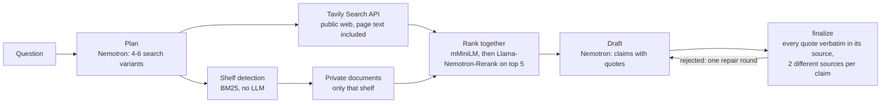

# Searchify x Tavily

**Tavily searches the public web. Searchify adds what is not on the web: your company's own
documents.** Ask one question and get one answer in which every claim is backed by verbatim
quotes from two different sources, each labelled *privat* (your intranet folder) or
*öffentlich* (the open web via Tavily). Searchify complements Tavily, it does not replace it.

Built for the Nebius Build Week hackathon (18 October 2026) with NVIDIA Nemotron on the Nebius
Token Factory, NVIDIA Llama-Nemotron-Rerank and the Tavily Search API.

```
$ python -m app.demo --privat-tavily --frage 1
  frage     Erfüllt unsere interne KI-Richtlinie die aktuellen Pflichten aus dem EU AI Act?
  modell    nvidia/nemotron-3-super-120b-a12b
  quellen   privat + tavily
  plan      6 Suchvarianten
  regal     KI
  suche     12 Dokumente und Seiten (10 tavily, 2 privat)
  rerank    mMiniLM sortiert alles, Nemotron die Top 5
  entwurf   Runde 1: 3 Aussagen mit Zitaten
  prüfung   3 Aussagen belegt, 0 abgelehnt

Unsere interne KI-Richtlinie sieht keine verpflichtende Schulung zu KI-Werkzeugen vor, während
der EU AI Act KI-Kompetenz verlangt. [1][3]
    [1] privat      privat://ki-richtlinie.md
        „Eine eigene Schulung zu KI-Werkzeugen ist derzeit nicht vorgesehen."
    [3] öffentlich  rtr.at
        „Mit KI-Kompetenz wird abstrakt umschrieben, was notwendig ist, ..."
```

The company in `demo/intranet` (Nordlicht Analytics GmbH) is fictional, and every document
there says so.

## How it works



1. **Plan.** Nemotron (`nvidia/nemotron-3-super-120b-a12b`) writes 4 to 6 search variants:
   synonyms, another language, an official-source query.
2. **Gather.** Public pages come from the Tavily Search API; the page text comes with each
   result, so nothing is fetched twice. Private documents come from a local folder.
3. **Library.** At ingest, once and offline, a local model puts every private document on
   a shelf and writes a one-sentence summary. At question time there is no LLM in this
   step: BM25 over word stems picks the shelf, and only that shelf is searched.
4. **Rank together.** Private and public passages compete in one ranking: mMiniLM scores all
   passages, Llama-Nemotron-Rerank re-orders the top 5. Each kind of source keeps at least 3
   of the 10 seats the answer model sees.
5. **Answer and check.** Nemotron drafts claims with quotes. `finalize` is plain code: a
   quote counts only if it appears verbatim (after normalising quotes, dashes and spaces) in
   its source and has at least 4 words, and a claim needs quotes from 2 different sources.
   A rejected draft goes back to Nemotron once, with the reasons. When private and public
   sources are both present, the model is asked for comparison claims that cite one of each.

## Setup

```
python3.12 -m venv .venv      # Python 3.11 or newer (macOS ships 3.9, too old for torch)
.venv/bin/python -m pip install -r requirements.txt
cp .env.example .env          # add TAVILY_API_KEY and NEBIUS_API_KEY
.venv/bin/python -m app.demo --privat-tavily --frage 1
```

- Keys live only in `.env` (gitignored) or the environment, never in code or logs.
- Without `NEBIUS_API_KEY` the plan and draft steps fall back to a heuristic and an
  extractive stub; everything else runs for real.
- Without `TAVILY_API_KEY` the public side is empty.
- The rerankers download on first use (mMiniLM about 470 MB, Nemotron-Rerank about 2.5 GB).
  On a laptop without a GPU use `--bm25`, which ranks without any model.
- Use your own documents: `PRIVATE_DIR=/path/to/folder`, then build the shelves once (below).

## Interfaces

### Python: `app.research.research`

```python
from app.research import research
result = research("Erfüllt unsere KI-Richtlinie den EU AI Act?",
                  quellen=["privat", "tavily"],     # any of "web", "tavily", "privat"
                  rerank_mode="l+nemotron",         # "l+nemotron", "l", "nemotron", "bm25"
                  on_step=lambda step, info: print(step, info))
result.claims       # [Claim(text, citations=[{"source": n, "quote": "..."}])]
result.sources      # [Source(n, url, title, site, origin, label, score, stage, ...)]
result.as_dict()    # JSON-ready, cited sources only, each with "label": "privat" | "öffentlich"
```

`on_step` reports `start`, `plan`, `regal`, `search`, `read`, `rerank`, `draft`,
`draft_error`, `finalize` and `done`. `quellen=["web"]` uses the built-in web search instead
of Tavily (`SEARCH_BACKEND`: `ddgs` without a key, `searxng` self-hosted, or `serper`).

### Command line: `app.demo`

| Flag | Effect |
|---|---|
| `--privat-tavily` | private folder plus Tavily (otherwise the built-in web search) |
| `--frage 1` / `--frage 2` | demo question 1 or 2 from `demo/fragen.txt` |
| `--bm25` | rank without any model |
| `--nur-l` / `--nur-nemotron` | only mMiniLM / only Nemotron-Rerank |
| `--json` | also print the result as JSON |

### Library ingest: `app.private_ingest`

```
python -m app.private_ingest demo/intranet --url http://127.0.0.1:8080/v1 --modell qwen3-4b
```

Sends all documents of the folder in one request to any OpenAI-compatible endpoint (for
example `llama-server`) and writes `<folder>.regale.json` next to the folder: shelf and
summary per document. The shelves in `demo/intranet.regale.json` were sorted by Qwen3-4B
(GGUF Q4_K_M on llama-server) at ingest. Without that file all private documents are searched.

### MCP server: `app.mcp_server`

```
claude mcp add searchify -- /path/to/.venv/bin/python -m app.mcp_server
```

Plain stdio JSON-RPC (protocol 2024-11-05), run from the repo root. Tools:

| Tool | Arguments | Returns |
|---|---|---|
| `research` | `question`, `sources` (array of `web`, `tavily`, `private`, default `["web"]`) | claims with verified quotes and labelled sources |
| `search` | `query`, `max_results` (default 8, max 20) | title, url, snippet per hit (built-in web search) |
| `read` | `urls` (up to 10) | main text per page, plus the URLs that failed |

### External APIs used

| API | Used for | Key |
|---|---|---|
| Tavily Search (`POST https://api.tavily.com/search`, `include_raw_content: "markdown"`) | public web results with page text | `TAVILY_API_KEY` |
| Nebius Token Factory (OpenAI-compatible) | Nemotron for plan and draft | `NEBIUS_API_KEY` |
| Hugging Face Hub | downloads `cross-encoder/mmarco-mMiniLMv2-L12-H384-v1` and `nvidia/llama-nemotron-rerank-1b-v2` (pinned revision) | none |

## Tests

```
.venv/bin/python -m pip install pytest
EXTRACT_WORKERS=2 .venv/bin/python -m pytest -q tests     # no network, no model downloads
```

## Repository layout

| Path | Contents |
|---|---|
| `app/research.py` | the agent: plan, gather, rank, draft, `finalize` |
| `app/tavily_search.py` | Tavily Search API client |
| `app/private.py`, `app/private_ingest.py` | private folder, shelves, ingest |
| `app/nemotron.py` | Nemotron client (Nebius Token Factory) |
| `app/rerank.py`, `app/extract.py`, `app/search.py` | ranking, text extraction, built-in web search |
| `app/demo.py`, `app/mcp_server.py` | demo CLI and MCP server |
| `demo/` | fictional intranet, shelves file and the two demo questions |
| `minitron/` | Minitron-style pruning and distillation of Llama-Nemotron-Rerank |

## License

Code: MIT, see [LICENSE](LICENSE). Model weights keep their own licenses:
Llama-Nemotron-Rerank is released under OpenMDW-1.1 plus the Llama 3.2 Community License.
Built with Llama.
